<picture>
  <source media="(prefers-color-scheme: dark)" srcset="https://raw.githubusercontent.com/Adrian-Gonzalez-E/Adrian-Gonzalez-E/output/galaga-contribution-graph-dark.svg">
  <source media="(prefers-color-scheme: light)" srcset="https://raw.githubusercontent.com/Adrian-Gonzalez-E/Adrian-Gonzalez-E/output/galaga-contribution-graph.svg">
  
</picture>

<!-- readme-atelier:start -->
<!-- Generated by Readme Atelier (https://github.com/monokernn/readme-atelier). Edit atelier.yml instead of this block. -->

<!-- readme-atelier:end -->

