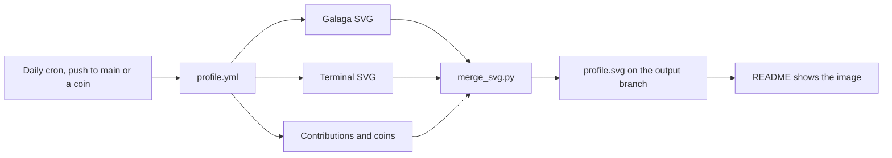

# How this profile works

GitHub strips JavaScript from READMEs, but browsers still play animations declared inside an SVG. The profile is a single animated SVG, regenerated by GitHub Actions. Nothing runs when someone views it.

## Branches

- `main`: README, configuration, scripts and workflows.
- `output`: only generated images. Every run replaces its content, so large SVGs do not pile up in the history of `main`.
- `preview-*`: images generated by manual runs on other branches, so a pull request can show its result without touching the profile.

## Parts of the image

| Part | Source |
|---|---|
| Galaga | [`abozanona/pacman-contribution-graph`](https://github.com/abozanona/pacman-contribution-graph), played on the contribution graph |
| Terminal window | [`monokernn/readme-atelier`](https://github.com/monokernn/readme-atelier), pinned to a commit and configured in `atelier.yml` |
| Scoreboard, end screen and credits | `scripts/mission_section.py` |
| Seasons | `scripts/seasons.py` |

`scripts/merge_svg.py` nests Galaga inside the terminal window. If an input changes format, it fails without writing anything and the last good image stays online.

### End screen

Galaga erases the last block right at the end of its animation cycle and would then restart. The script plays it only once and freezes the empty board, so `ALL BUGS CLEARED` appears exactly when the last block falls, followed by a call to insert a coin. A coin adds to `COINS`, but the image cannot react per visitor: only reloading the page starts a new game.

### Insert coin

The link under the image opens a pre-filled issue. `insert-coin.yml` runs only when the title is exactly `INSERT COIN`: it labels the issue, closes it and requests a new image. The scoreboard counts unique authors of labeled issues, so each player adds one coin. The workflow never reads the issue body, and it runs no repository code.

### Seasons

Snow falls from 1 December to 6 January, and a film strip plays from 15 to 30 September for the [Zinemaldia](https://www.sansebastianfestival.com/) film festival. To preview one on any date, run the workflow manually and choose it in the `season` input.

## Secrets

| Secret | Purpose |
|---|---|
| `METRICS_TOKEN` | Classic personal access token without scopes. It reads contribution counts, including private ones if the profile shows them. Never grant it `repo`: the image is public. |
| `BIRTH_DATE` | `YYYY-MM-DD`. Only the resulting age is published. |

## Limits

- The image is not real time. It changes when the workflow runs, and GitHub caches it for about 5 minutes.
- The animation restarts when the image loads, and the end screen appears about 83 seconds later, depending on the number of contributions.
- `merge_svg.py` relies on the SVG structure of the pinned `readme-atelier` commit.

## Reuse it

Copyright © 2026 Adrián González. The code is licensed under the [GNU AGPL v3.0](../LICENSE): if you distribute a modified version or offer it over a network, you must share its source under the same license. To adapt it, use a repository named after your username, change `atelier.yml` and the texts in `scripts/mission_section.py`, create both secrets and run the workflow.

Run the checks with `python3 scripts/test_merge_svg.py`.
